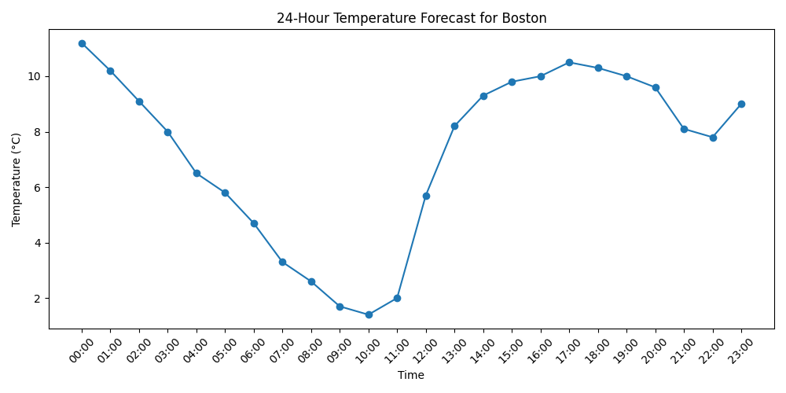

# Project 19 — Weather Data Pipeline

A command-line weather app: Open-Meteo geocoding and forecasts (free, no API key), an SQLite cache, and a
24-hour temperature chart in the city's local time.

## Preview



## Usage

```bash
uv run python main.py Boston                     # opens the chart in a window
uv run python main.py Boston --save boston.png   # writes the chart to a file instead
uv run python main.py Boston --reset             # clears the cache first
uv run pytest -q                                 # offline tests, also run in CI
```

## How it works

| File | Role |
|------|------|
| `service.py` | Geocodes the city, then fetches current conditions and hourly forecast in the city's time zone |
| `database.py` | Caches each city's result for an hour, so repeated lookups make no API calls |
| `plotter.py` | Plots the next 24 hours, shown in a window or saved as PNG |
| `main.py` | Command-line entry point |
| `tests/` | 7 tests with simulated Open-Meteo responses: no network needed |

## Fixed in this version

Writing tests surfaced three bugs in the first version:

- **"Current temperature" was midnight's forecast.** It used the first hourly value; it now uses Open-Meteo's
  `current` field, and the forecast starts at the current hour.
- **Times were in UTC but labelled as local.** Requests now use the city's time zone, and the chart's axis names it.
- **The cache saved nothing.** It called the API on every run and only reused one stored number; it now returns
  the whole cached result for an hour without touching the network.

Requests also have timeouts, and network errors end with a clear message instead of a traceback.

## Stack

Python · requests · SQLite · Matplotlib · pytest
